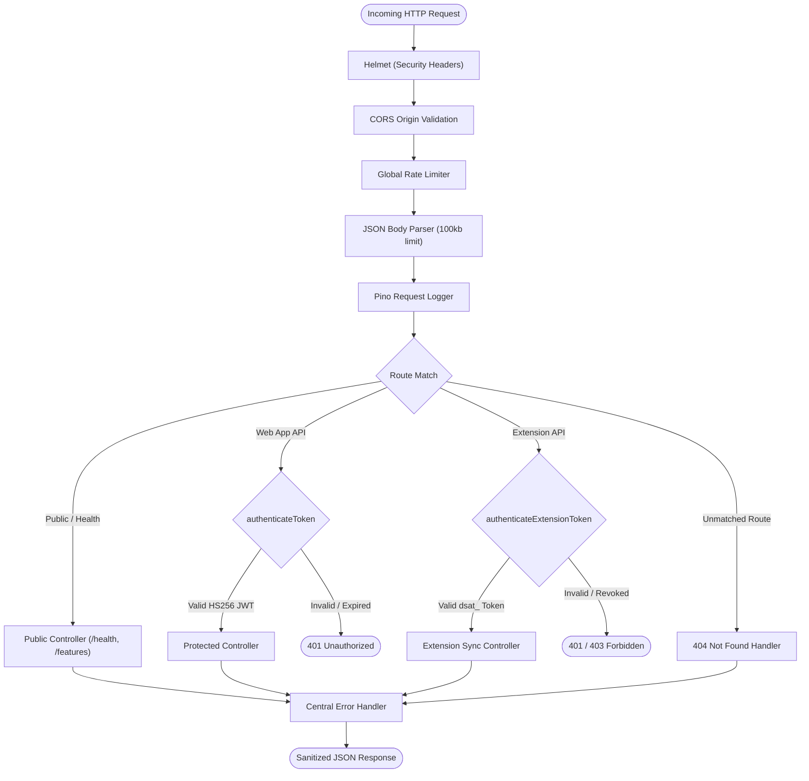
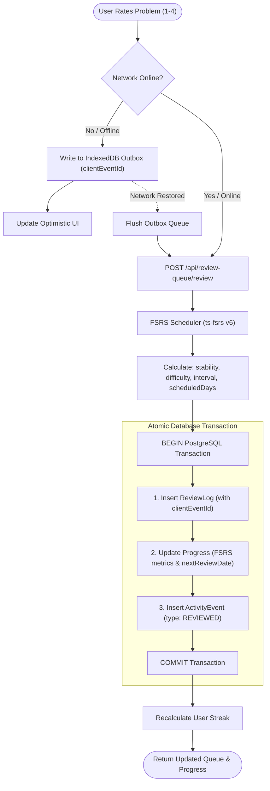

# System Architecture & Technical Design

This document details the runtime architecture, trust boundaries, network topologies, middleware pipelines, authentication mechanisms, and spaced repetition data flows for **DSA Tracker Pro**.

---

## 1. System Context & Trust Boundaries

The system is partitioned into four explicit trust zones:
1. **User Device Boundary:** Client-side execution in Chromium/WebKit browsers and the Chrome Extension Manifest V3 background service worker. Local persistent storage is handled by IndexedDB.
2. **Application Server Boundary:** Decoupled Next.js 16 (React 19) frontend and Express 5 (Node 22) API.
3. **Data Tier:** PostgreSQL database managed via Prisma ORM and optional Upstash/local Redis instance for distributed rate limiting.
4. **Third-Party Boundary:** Isolated external integrations for OAuth identity (Google), generative AI tutoring (Google Gemini API), and problem catalog sync (LeetCode).

```mermaid
flowchart TB
    subgraph UserMachine["User Device Boundary"]
        Browser["Web Browser / PWA"]
        Ext["Chrome Extension (MV3)"]
        IDB[("IndexedDB Outbox")]
        Browser <--> IDB
    end

    subgraph AppServer["Application Tier"]
        NextApp["Next.js Frontend (:3005)"]
        Proxy["Same-Origin Proxy (/api)"]
        ExpressAPI["Express 5 Backend (:3001)"]
        NextApp --> Proxy
        Proxy --> ExpressAPI
    end

    subgraph DataTier["Data Tier"]
        PG[("PostgreSQL Database")]
        ExpressAPI --> PG
    end

    subgraph ThirdParty["Third-Party Boundary"]
        GoogleAuth["Google OAuth 2.0"]
        GeminiAPI["Google Gemini AI"]
        LeetCode["LeetCode Site"]
    end

    Browser --> NextApp
    Ext -.->|"Bearer dsat_..."| ExpressAPI
    Ext -->|"DOM Detection"| LeetCode
    NextApp <--> GoogleAuth
    ExpressAPI --> GeminiAPI
```

---

## 2. Request & Middleware Pipeline

The Express backend strictly enforces the Phase 0 middleware ordering. Requests are filtered and sanitized sequentially before dispatching to route handlers:

### Pipeline Guarantees
- **Payload Size Control:** Body parser caps payloads at 100kb to mitigate memory exhaustion and denial-of-service vectors.
- **Redaction Policy:** Pino logger automatically redacts sensitive headers including `authorization`, `cookie`, `set-cookie`, `x-pairing-token`, and credentials.
- **Fail-Safe Exception Handling:** Central error handler intercepts all unhandled errors, logs a unique error fingerprint, and sanitizes production responses to prevent leaking internal database schemas or stack traces.

---

## 3. Authentication & Credential Architecture

DSA Tracker Pro strictly separates interactive human sessions from automated extension pairing tokens.

### A. Web Application Session Exchange
1. The user logs in via Google OAuth handled by NextAuth in `frontend/src/app/api/auth/[...nextauth]/route.ts`.
2. NextAuth creates an encrypted HTTP-only session cookie (`next-auth.session-token`).
3. For backend API communication, the client requests a short-lived backend JWT (10-minute expiry) via `/api/backend-token`.
4. The client's Axios interceptor attaches `Authorization: Bearer <token>` to requests routed through the same-origin Next.js proxy.
5. The backend validates the HS256 signature using `BACKEND_JWT_SECRET` and extracts the user identity without accessing the frontend cookie jar.

### B. Chrome Extension Device Pairing Flow
1. In the Web UI Settings (`/settings`), the user generates a new device pairing token.
2. The server mints a high-entropy cryptographically secure token: `dsat_` + 32 bytes base64url (`crypto.randomBytes(32)`).
3. The server computes the SHA-256 hash of the token and persists an `ExtensionDevice` record. The raw token is displayed to the user once and never persisted.
4. The user pastes the pairing token into the extension popup, storing it in `chrome.storage.local`.
5. Upon detecting a LeetCode problem submission, the extension issues an API sync request with `Authorization: Bearer dsat_...`.
6. Express hashes the incoming token with SHA-256 and matches it against `ExtensionDevice.tokenHash`, validating device expiration, revocation status, and allowed scopes (`sync:write`).

```mermaid
sequenceDiagram
    autonumber
    actor User as Developer
    participant Ext as Chrome Extension
    participant Web as Next.js Web App
    participant API as Express API
    participant DB as PostgreSQL

    rect rgb(20, 24, 39)
        Note over User,DB: Flow A: Web Application Authentication
        User->>Web: Login via Google OAuth
        Web->>Web: Issue Encrypted Session Cookie
        Web->>API: GET /api/backend-token (Mint JWT)
        API-->>Web: Return 10m HS256 Backend JWT
        Web->>API: API Request (Bearer JWT)
        API->>DB: Query Tenant Progress
        API-->>Web: JSON Data
    end

    rect rgb(15, 23, 42)
        Note over User,DB: Flow B: Extension Pairing & Sync
        User->>Web: Click "Generate Pairing Token"
        Web->>API: POST /api/extension/devices
        API->>API: Generate dsat_ + randomBytes(32)
        API->>DB: Store SHA-256(token) in ExtensionDevice
        API-->>Web: Show plaintext dsat_ token (one-time)
        User->>Ext: Paste token into Extension popup
        Ext->>Ext: Save token in chrome.storage.local
        Ext->>API: POST /api/extension/sync (Bearer dsat_...)
        API->>DB: Lookup ExtensionDevice by SHA-256
        API->>DB: Bulk Upsert Progress & ActivityEvent
        API-->>Ext: Return 200 SyncReceipt
    end
```

---

## 4. Spaced Repetition (FSRS) & Offline Review Pipeline

DSA Tracker Pro replaces legacy SM-2 with the **Free Spaced Repetition Scheduler (FSRS v6)**. Memory retention is modeled using multidimensional stability, difficulty, lapse counters, and repetition counts.

### Spaced Repetition Review Lifecycle
1. The user reviews a card and selects a grade: `Again` (1), `Hard` (2), `Good` (3), or `Easy` (4).
2. If online: The mutation is immediately dispatched to `/api/review-queue/review`.
3. If offline: The mutation is written to the local IndexedDB Outbox with a client-generated UUID (`clientEventId`). Optimistic UI immediately decrements the queue.
4. When connectivity resumes (`window.ononline`), the outbox flushes pending reviews with guaranteed idempotency via `clientEventId`.
5. The scheduler computes updated memory metrics (`stability`, `difficulty`, `interval`, `scheduledDays`).
6. A single PostgreSQL database transaction atomically executes three operations:
   - Inserts `ReviewLog` (audit record with memory state snapshot).
   - Updates `Progress` (new FSRS metrics, repetition count, state, next review date).
   - Inserts `ActivityEvent` (type: `REVIEWED`).
7. Daily streak metrics are dynamically recomputed from the continuous sequence of `ActivityEvent` timestamps.

---

## 5. Technology Stack & Runtime Specifications

| Tier | Technology | Version | Purpose |
| :--- | :--- | :--- | :--- |
| **Frontend** | Next.js (App Router) | `16.1.6` | Server-rendered and interactive client UI shell |
| **UI Library** | React | `19.2.3` | Reactive component tree, concurrent rendering |
| **Backend** | Express | `5.2.1` | REST API routing, security middleware |
| **Runtime** | Node.js | `>=22.0.0` | Server-side JavaScript runtime |
| **ORM** | Prisma | `5.22.0` | Type-safe PostgreSQL client and migrations |
| **Database** | PostgreSQL | `>=15.0` | Relational data persistence, indexed queries |
| **Cache / Rate Limit** | Upstash / Redis | `1.41.0` | Distributed sliding-window rate limit store |
| **Extension** | Manifest V3 | `3.0` | LeetCode DOM parsing and background sync bridge |
| **Spaced Repetition** | `ts-fsrs` | `6.0.0` | Spaced repetition memory modeling |
| **AI Integration** | `@google/genai` | `2.21.0` | Gemini 2.5 Flash code architect and hint tutoring |
| **Testing** | Vitest & Playwright | `4.1.11` / `1.65.0` | Unit, integration, contract, and E2E automation |
