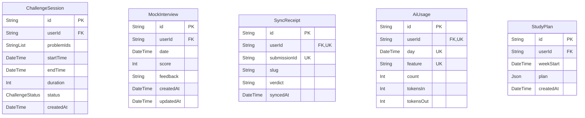

# Entity-Relationship Diagram: Assessment & Operational Domain

## Domain Description
Encapsulates timed coding arena challenges, AI mock interview transcripts, AI study plans, Gemini API rate-limiting usage logs, and extension sync receipts.
Provides auditing for AI resources and offline synchronization integrity.

> [!NOTE]
> Cross-domain references:
> - References `User` (Identity domain) across all operational models.
> - References `Topic` (Curriculum domain) in `StudyPlan` targets.

## Visual Schema

## Models & Indexes Detail

### `ChallengeSession` (table: `ChallengeSession`)

| Field | Type | Attributes | Constraints |
| :--- | :--- | :--- | :--- |
| `id` | `String` | scalar | PK, NOT NULL, DEFAULT(uuid(4)) |
| `userId` | `String` | scalar | FK -> User.id, NOT NULL |
| `problemIds` | `StringList` | scalar | NOT NULL |
| `startTime` | `DateTime` | scalar | NOT NULL, DEFAULT(now) |
| `endTime` | `DateTime` | scalar | — |
| `duration` | `Int` | scalar | NOT NULL |
| `status` | `ChallengeStatus` | enum | NOT NULL, DEFAULT(IN_PROGRESS) |
| `createdAt` | `DateTime` | scalar | NOT NULL, DEFAULT(now) |

### `MockInterview` (table: `MockInterview`)

| Field | Type | Attributes | Constraints |
| :--- | :--- | :--- | :--- |
| `id` | `String` | scalar | PK, NOT NULL, DEFAULT(uuid(4)) |
| `userId` | `String` | scalar | FK -> User.id, NOT NULL |
| `date` | `DateTime` | scalar | NOT NULL |
| `score` | `Int` | scalar | — |
| `feedback` | `String` | scalar | — |
| `createdAt` | `DateTime` | scalar | NOT NULL, DEFAULT(now) |
| `updatedAt` | `DateTime` | scalar | NOT NULL |

### `SyncReceipt` (table: `sync_receipts`)

| Field | Type | Attributes | Constraints |
| :--- | :--- | :--- | :--- |
| `id` | `String` | scalar | PK, NOT NULL, DEFAULT(uuid(4)) |
| `userId` | `String` | scalar | FK -> User.id, NOT NULL |
| `submissionId` | `String` | scalar | NOT NULL |
| `slug` | `String` | scalar | NOT NULL |
| `verdict` | `String` | scalar | NOT NULL |
| `syncedAt` | `DateTime` | scalar | NOT NULL, DEFAULT(now) |

**Key Indexes & Constraints:**
- Unique Index: `(userId, submissionId)`

### `AiUsage` (table: `ai_usages`)

| Field | Type | Attributes | Constraints |
| :--- | :--- | :--- | :--- |
| `id` | `String` | scalar | PK, NOT NULL, DEFAULT(uuid(4)) |
| `userId` | `String` | scalar | FK -> User.id, NOT NULL |
| `day` | `DateTime` | scalar | NOT NULL |
| `feature` | `String` | scalar | NOT NULL |
| `count` | `Int` | scalar | NOT NULL, DEFAULT(0) |
| `tokensIn` | `Int` | scalar | — |
| `tokensOut` | `Int` | scalar | — |

**Key Indexes & Constraints:**
- Unique Index: `(userId, day, feature)`

### `StudyPlan` (table: `study_plans`)

| Field | Type | Attributes | Constraints |
| :--- | :--- | :--- | :--- |
| `id` | `String` | scalar | PK, NOT NULL, DEFAULT(uuid(4)) |
| `userId` | `String` | scalar | FK -> User.id, NOT NULL |
| `weekStart` | `DateTime` | scalar | NOT NULL |
| `plan` | `Json` | scalar | NOT NULL |
| `createdAt` | `DateTime` | scalar | NOT NULL, DEFAULT(now) |

