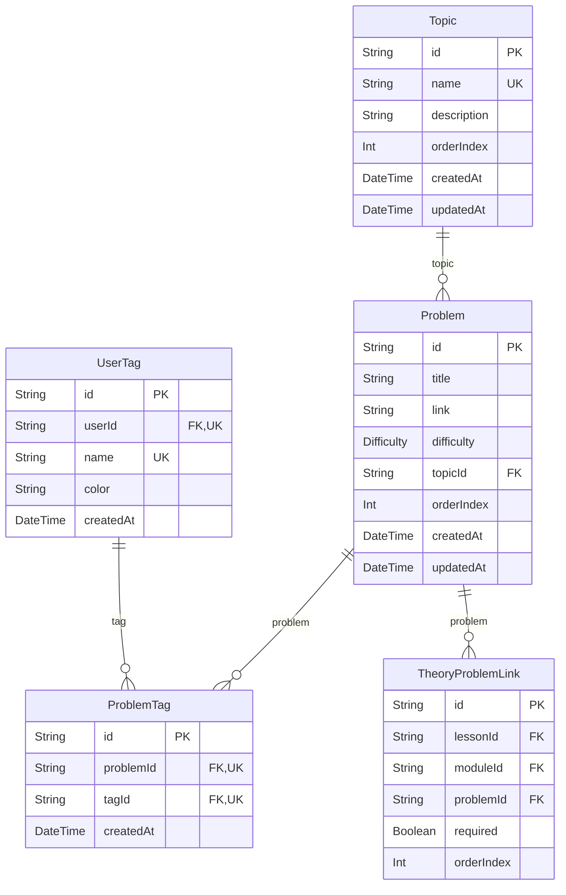

# Entity-Relationship Diagram: Curriculum & Problem Catalog Domain

## Domain Description
Models the core DSA curriculum, categorizing LeetCode coding problems into canonical topics and tags.
Enables many-to-many problem tagging and bidirectional linking between problems and theory lessons.

> [!NOTE]
> Cross-domain references:
> - `Problem` is referenced by `Progress`, `ReviewLog`, `ActivityEvent`, `SolutionHistory`, `ProblemNote`, and `Bookmark` in the Progress domain.
> - `Topic` is referenced by `TheoryModule` (Theory domain) and `StudyPlan` (Assessment domain).

## Visual Schema

## Models & Indexes Detail

### `Topic` (table: `Topic`)

| Field | Type | Attributes | Constraints |
| :--- | :--- | :--- | :--- |
| `id` | `String` | scalar | PK, NOT NULL, DEFAULT(uuid(4)) |
| `name` | `String` | scalar | UNIQUE, NOT NULL |
| `description` | `String` | scalar | — |
| `orderIndex` | `Int` | scalar | NOT NULL |
| `createdAt` | `DateTime` | scalar | NOT NULL, DEFAULT(now) |
| `updatedAt` | `DateTime` | scalar | NOT NULL |

**Key Indexes & Constraints:**
- Unique Constraint: `(name)`

### `Problem` (table: `Problem`)

| Field | Type | Attributes | Constraints |
| :--- | :--- | :--- | :--- |
| `id` | `String` | scalar | PK, NOT NULL, DEFAULT(uuid(4)) |
| `title` | `String` | scalar | NOT NULL |
| `link` | `String` | scalar | — |
| `difficulty` | `Difficulty` | enum | NOT NULL, DEFAULT(EASY) |
| `topicId` | `String` | scalar | FK -> Topic.id, NOT NULL |
| `orderIndex` | `Int` | scalar | NOT NULL |
| `createdAt` | `DateTime` | scalar | NOT NULL, DEFAULT(now) |
| `updatedAt` | `DateTime` | scalar | NOT NULL |

### `UserTag` (table: `user_tags`)

| Field | Type | Attributes | Constraints |
| :--- | :--- | :--- | :--- |
| `id` | `String` | scalar | PK, NOT NULL, DEFAULT(uuid(4)) |
| `userId` | `String` | scalar | FK -> User.id, NOT NULL |
| `name` | `String` | scalar | NOT NULL |
| `color` | `String` | scalar | NOT NULL, DEFAULT(#6366f1) |
| `createdAt` | `DateTime` | scalar | NOT NULL, DEFAULT(now) |

**Key Indexes & Constraints:**
- Unique Index: `(userId, name)`

### `ProblemTag` (table: `problem_tags`)

| Field | Type | Attributes | Constraints |
| :--- | :--- | :--- | :--- |
| `id` | `String` | scalar | PK, NOT NULL, DEFAULT(uuid(4)) |
| `problemId` | `String` | scalar | FK -> Problem.id, NOT NULL |
| `tagId` | `String` | scalar | FK -> UserTag.id, NOT NULL |
| `createdAt` | `DateTime` | scalar | NOT NULL, DEFAULT(now) |

**Key Indexes & Constraints:**
- Unique Index: `(problemId, tagId)`

### `TheoryProblemLink` (table: `theory_problem_links`)

| Field | Type | Attributes | Constraints |
| :--- | :--- | :--- | :--- |
| `id` | `String` | scalar | PK, NOT NULL, DEFAULT(uuid(4)) |
| `lessonId` | `String` | scalar | FK -> TheoryLesson.id |
| `moduleId` | `String` | scalar | FK -> TheoryModule.id |
| `problemId` | `String` | scalar | FK -> Problem.id, NOT NULL |
| `required` | `Boolean` | scalar | NOT NULL, DEFAULT(true) |
| `orderIndex` | `Int` | scalar | NOT NULL, DEFAULT(0) |

