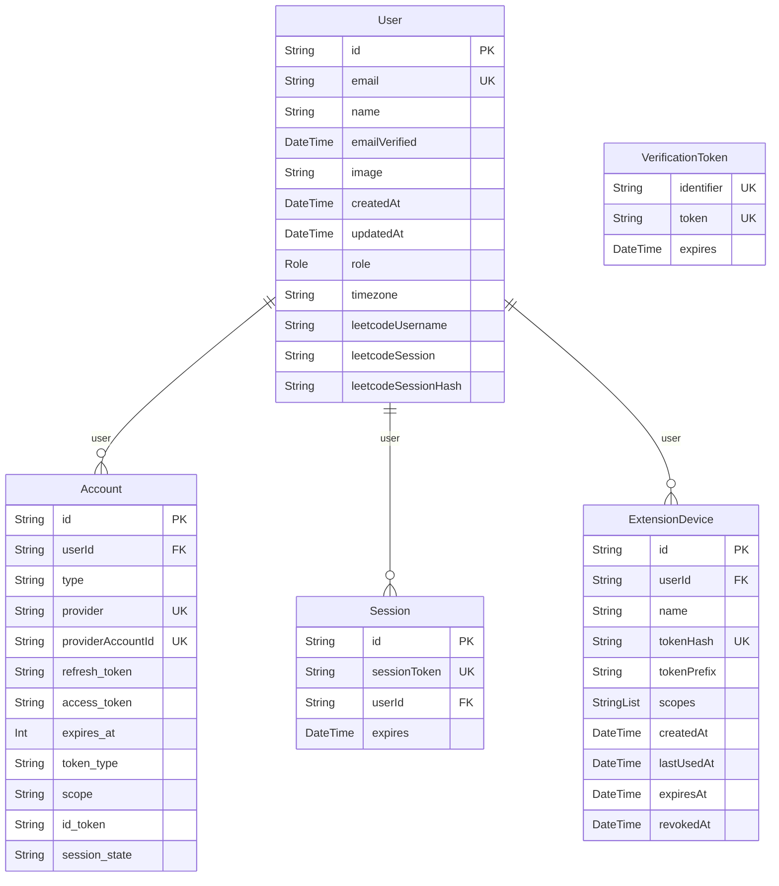

# Entity-Relationship Diagram: Identity & Authentication Domain

## Domain Description
Manages user identity, OAuth provider accounts, active web sessions, NextAuth verification tokens, and paired Chrome Extension devices.
Serves as the root aggregate for tenant-scoped data isolation across all user activity.

> [!NOTE]
> Cross-domain references:
> - `User` is the foreign-key root for `Progress`, `ReviewLog`, `ActivityEvent`, `Streak`, `SolutionHistory`, `ProblemNote`, `Bookmark` (Progress domain), `UserTheoryLessonProgress` (Theory domain), and `ChallengeSession`, `MockInterview`, `StudyPlan`, `AiUsage`, `SyncReceipt` (Assessment domain).

## Visual Schema

## Models & Indexes Detail

### `Account` (table: `accounts`)

| Field | Type | Attributes | Constraints |
| :--- | :--- | :--- | :--- |
| `id` | `String` | scalar | PK, NOT NULL, DEFAULT(uuid(4)) |
| `userId` | `String` | scalar | FK -> User.id, NOT NULL |
| `type` | `String` | scalar | NOT NULL |
| `provider` | `String` | scalar | NOT NULL |
| `providerAccountId` | `String` | scalar | NOT NULL |
| `refresh_token` | `String` | scalar | — |
| `access_token` | `String` | scalar | — |
| `expires_at` | `Int` | scalar | — |
| `token_type` | `String` | scalar | — |
| `scope` | `String` | scalar | — |
| `id_token` | `String` | scalar | — |
| `session_state` | `String` | scalar | — |

**Key Indexes & Constraints:**
- Unique Index: `(provider, providerAccountId)`

### `Session` (table: `sessions`)

| Field | Type | Attributes | Constraints |
| :--- | :--- | :--- | :--- |
| `id` | `String` | scalar | PK, NOT NULL, DEFAULT(uuid(4)) |
| `sessionToken` | `String` | scalar | UNIQUE, NOT NULL |
| `userId` | `String` | scalar | FK -> User.id, NOT NULL |
| `expires` | `DateTime` | scalar | NOT NULL |

**Key Indexes & Constraints:**
- Unique Constraint: `(sessionToken)`

### `User` (table: `User`)

| Field | Type | Attributes | Constraints |
| :--- | :--- | :--- | :--- |
| `id` | `String` | scalar | PK, NOT NULL, DEFAULT(uuid(4)) |
| `email` | `String` | scalar | UNIQUE, NOT NULL |
| `name` | `String` | scalar | — |
| `emailVerified` | `DateTime` | scalar | — |
| `image` | `String` | scalar | — |
| `createdAt` | `DateTime` | scalar | NOT NULL, DEFAULT(now) |
| `updatedAt` | `DateTime` | scalar | NOT NULL |
| `role` | `Role` | enum | NOT NULL, DEFAULT(USER) |
| `timezone` | `String` | scalar | NOT NULL, DEFAULT(UTC) |
| `leetcodeUsername` | `String` | scalar | — |
| `leetcodeSession` | `String` | scalar | — |
| `leetcodeSessionHash` | `String` | scalar | — |

**Key Indexes & Constraints:**
- Unique Constraint: `(email)`

### `VerificationToken` (table: `verification_tokens`)

| Field | Type | Attributes | Constraints |
| :--- | :--- | :--- | :--- |
| `identifier` | `String` | scalar | NOT NULL |
| `token` | `String` | scalar | UNIQUE, NOT NULL |
| `expires` | `DateTime` | scalar | NOT NULL |

**Key Indexes & Constraints:**
- Unique Index: `(identifier, token)`
- Unique Constraint: `(token)`

### `ExtensionDevice` (table: `extension_devices`)

| Field | Type | Attributes | Constraints |
| :--- | :--- | :--- | :--- |
| `id` | `String` | scalar | PK, NOT NULL, DEFAULT(uuid(4)) |
| `userId` | `String` | scalar | FK -> User.id, NOT NULL |
| `name` | `String` | scalar | NOT NULL |
| `tokenHash` | `String` | scalar | UNIQUE, NOT NULL |
| `tokenPrefix` | `String` | scalar | NOT NULL |
| `scopes` | `StringList` | scalar | NOT NULL, DEFAULT(undefined) |
| `createdAt` | `DateTime` | scalar | NOT NULL, DEFAULT(now) |
| `lastUsedAt` | `DateTime` | scalar | — |
| `expiresAt` | `DateTime` | scalar | — |
| `revokedAt` | `DateTime` | scalar | — |

**Key Indexes & Constraints:**
- Unique Constraint: `(tokenHash)`

