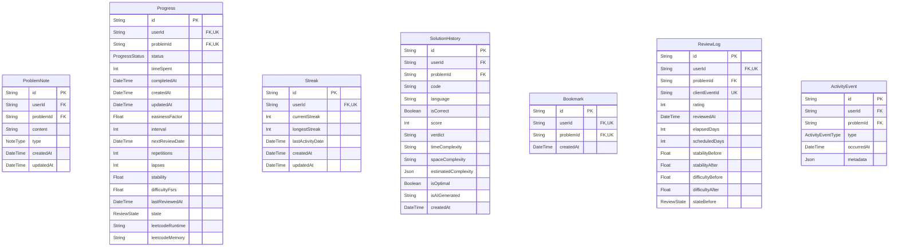

# Entity-Relationship Diagram: Progress & Spaced Repetition Domain

## Domain Description
Drives the core spaced repetition engine (FSRS algorithm), review queues, daily activity events for heatmaps, streaks, user code submissions, personal notes, and problem bookmarks.
Maintains a complete historical audit log of every memory state transition.

> [!NOTE]
> Cross-domain references:
> - Depends directly on `User` (Identity domain) for multi-tenant isolation.
> - Depends on `Problem` (Curriculum domain) for problem association and difficulty classification.

## Visual Schema

## Models & Indexes Detail

### `ProblemNote` (table: `problem_notes`)

| Field | Type | Attributes | Constraints |
| :--- | :--- | :--- | :--- |
| `id` | `String` | scalar | PK, NOT NULL, DEFAULT(uuid(4)) |
| `userId` | `String` | scalar | FK -> User.id, NOT NULL |
| `problemId` | `String` | scalar | FK -> Problem.id, NOT NULL |
| `content` | `String` | scalar | NOT NULL |
| `type` | `NoteType` | enum | NOT NULL, DEFAULT(LEARNING) |
| `createdAt` | `DateTime` | scalar | NOT NULL, DEFAULT(now) |
| `updatedAt` | `DateTime` | scalar | NOT NULL |

### `Progress` (table: `Progress`)

| Field | Type | Attributes | Constraints |
| :--- | :--- | :--- | :--- |
| `id` | `String` | scalar | PK, NOT NULL, DEFAULT(uuid(4)) |
| `userId` | `String` | scalar | FK -> User.id, NOT NULL |
| `problemId` | `String` | scalar | FK -> Problem.id, NOT NULL |
| `status` | `ProgressStatus` | enum | NOT NULL, DEFAULT(TODO) |
| `timeSpent` | `Int` | scalar | NOT NULL, DEFAULT(0) |
| `completedAt` | `DateTime` | scalar | — |
| `createdAt` | `DateTime` | scalar | NOT NULL, DEFAULT(now) |
| `updatedAt` | `DateTime` | scalar | NOT NULL |
| `easinessFactor` | `Float` | scalar | NOT NULL, DEFAULT(2.5) |
| `interval` | `Int` | scalar | NOT NULL, DEFAULT(0) |
| `nextReviewDate` | `DateTime` | scalar | — |
| `repetitions` | `Int` | scalar | NOT NULL, DEFAULT(0) |
| `lapses` | `Int` | scalar | NOT NULL, DEFAULT(0) |
| `stability` | `Float` | scalar | — |
| `difficultyFsrs` | `Float` | scalar | — |
| `lastReviewedAt` | `DateTime` | scalar | — |
| `state` | `ReviewState` | enum | NOT NULL, DEFAULT(NEW) |
| `leetcodeRuntime` | `String` | scalar | — |
| `leetcodeMemory` | `String` | scalar | — |

**Key Indexes & Constraints:**
- Unique Index: `(userId, problemId)`

### `Streak` (table: `Streak`)

| Field | Type | Attributes | Constraints |
| :--- | :--- | :--- | :--- |
| `id` | `String` | scalar | PK, NOT NULL, DEFAULT(uuid(4)) |
| `userId` | `String` | scalar | FK -> User.id, UNIQUE, NOT NULL |
| `currentStreak` | `Int` | scalar | NOT NULL, DEFAULT(0) |
| `longestStreak` | `Int` | scalar | NOT NULL, DEFAULT(0) |
| `lastActivityDate` | `DateTime` | scalar | NOT NULL, DEFAULT(now) |
| `createdAt` | `DateTime` | scalar | NOT NULL, DEFAULT(now) |
| `updatedAt` | `DateTime` | scalar | NOT NULL |

**Key Indexes & Constraints:**
- Unique Constraint: `(userId)`

### `SolutionHistory` (table: `solution_history`)

| Field | Type | Attributes | Constraints |
| :--- | :--- | :--- | :--- |
| `id` | `String` | scalar | PK, NOT NULL, DEFAULT(uuid(4)) |
| `userId` | `String` | scalar | FK -> User.id, NOT NULL |
| `problemId` | `String` | scalar | FK -> Problem.id, NOT NULL |
| `code` | `String` | scalar | NOT NULL |
| `language` | `String` | scalar | NOT NULL |
| `isCorrect` | `Boolean` | scalar | NOT NULL, DEFAULT(false) |
| `score` | `Int` | scalar | NOT NULL, DEFAULT(0) |
| `verdict` | `String` | scalar | — |
| `timeComplexity` | `String` | scalar | — |
| `spaceComplexity` | `String` | scalar | — |
| `estimatedComplexity` | `Json` | scalar | — |
| `isOptimal` | `Boolean` | scalar | NOT NULL, DEFAULT(false) |
| `isAIGenerated` | `String` | scalar | NOT NULL, DEFAULT(UNKNOWN) |
| `createdAt` | `DateTime` | scalar | NOT NULL, DEFAULT(now) |

### `Bookmark` (table: `bookmarks`)

| Field | Type | Attributes | Constraints |
| :--- | :--- | :--- | :--- |
| `id` | `String` | scalar | PK, NOT NULL, DEFAULT(uuid(4)) |
| `userId` | `String` | scalar | FK -> User.id, NOT NULL |
| `problemId` | `String` | scalar | FK -> Problem.id, NOT NULL |
| `createdAt` | `DateTime` | scalar | NOT NULL, DEFAULT(now) |

**Key Indexes & Constraints:**
- Unique Index: `(userId, problemId)`

### `ReviewLog` (table: `review_logs`)

| Field | Type | Attributes | Constraints |
| :--- | :--- | :--- | :--- |
| `id` | `String` | scalar | PK, NOT NULL, DEFAULT(uuid(4)) |
| `userId` | `String` | scalar | FK -> User.id, NOT NULL |
| `problemId` | `String` | scalar | FK -> Problem.id, NOT NULL |
| `clientEventId` | `String` | scalar | — |
| `rating` | `Int` | scalar | NOT NULL |
| `reviewedAt` | `DateTime` | scalar | NOT NULL, DEFAULT(now) |
| `elapsedDays` | `Int` | scalar | NOT NULL |
| `scheduledDays` | `Int` | scalar | NOT NULL |
| `stabilityBefore` | `Float` | scalar | — |
| `stabilityAfter` | `Float` | scalar | — |
| `difficultyBefore` | `Float` | scalar | — |
| `difficultyAfter` | `Float` | scalar | — |
| `stateBefore` | `ReviewState` | enum | NOT NULL |

**Key Indexes & Constraints:**
- Unique Index: `(userId, clientEventId)`

### `ActivityEvent` (table: `activity_events`)

| Field | Type | Attributes | Constraints |
| :--- | :--- | :--- | :--- |
| `id` | `String` | scalar | PK, NOT NULL, DEFAULT(uuid(4)) |
| `userId` | `String` | scalar | FK -> User.id, NOT NULL |
| `problemId` | `String` | scalar | FK -> Problem.id |
| `type` | `ActivityEventType` | enum | NOT NULL |
| `occurredAt` | `DateTime` | scalar | NOT NULL, DEFAULT(now) |
| `metadata` | `Json` | scalar | — |

