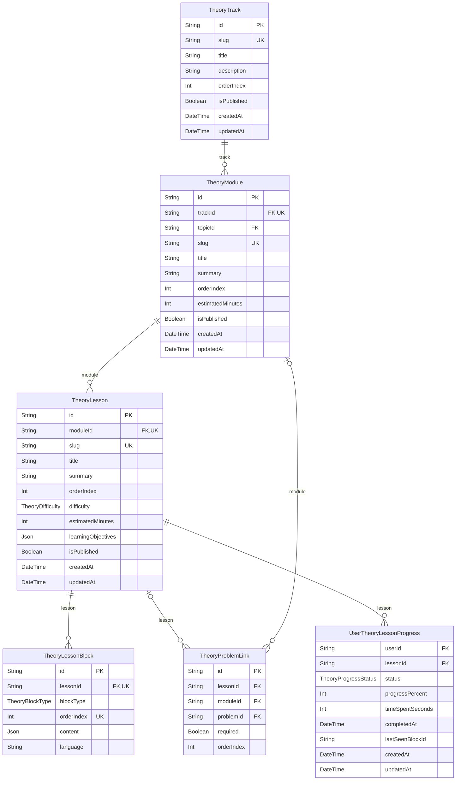

# Entity-Relationship Diagram: Theory & Conceptual Learning Domain

## Domain Description
Provides structured learning paths, theory modules, interactive lessons, markdown content blocks, and per-user lesson completion records.
Bridges theoretical understanding with practical problem solving.

> [!NOTE]
> Cross-domain references:
> - References `Topic` and `Problem` (Curriculum domain) for curricular alignment.
> - References `User` (Identity domain) for tracking individual lesson completion status.

## Visual Schema

## Models & Indexes Detail

### `TheoryTrack` (table: `theory_tracks`)

| Field | Type | Attributes | Constraints |
| :--- | :--- | :--- | :--- |
| `id` | `String` | scalar | PK, NOT NULL, DEFAULT(uuid(4)) |
| `slug` | `String` | scalar | UNIQUE, NOT NULL |
| `title` | `String` | scalar | NOT NULL |
| `description` | `String` | scalar | — |
| `orderIndex` | `Int` | scalar | NOT NULL, DEFAULT(0) |
| `isPublished` | `Boolean` | scalar | NOT NULL, DEFAULT(true) |
| `createdAt` | `DateTime` | scalar | NOT NULL, DEFAULT(now) |
| `updatedAt` | `DateTime` | scalar | NOT NULL |

**Key Indexes & Constraints:**
- Unique Constraint: `(slug)`

### `TheoryModule` (table: `theory_modules`)

| Field | Type | Attributes | Constraints |
| :--- | :--- | :--- | :--- |
| `id` | `String` | scalar | PK, NOT NULL, DEFAULT(uuid(4)) |
| `trackId` | `String` | scalar | FK -> TheoryTrack.id, NOT NULL |
| `topicId` | `String` | scalar | FK -> Topic.id |
| `slug` | `String` | scalar | NOT NULL |
| `title` | `String` | scalar | NOT NULL |
| `summary` | `String` | scalar | — |
| `orderIndex` | `Int` | scalar | NOT NULL, DEFAULT(0) |
| `estimatedMinutes` | `Int` | scalar | NOT NULL, DEFAULT(0) |
| `isPublished` | `Boolean` | scalar | NOT NULL, DEFAULT(true) |
| `createdAt` | `DateTime` | scalar | NOT NULL, DEFAULT(now) |
| `updatedAt` | `DateTime` | scalar | NOT NULL |

**Key Indexes & Constraints:**
- Unique Index: `(trackId, slug)`

### `TheoryLesson` (table: `theory_lessons`)

| Field | Type | Attributes | Constraints |
| :--- | :--- | :--- | :--- |
| `id` | `String` | scalar | PK, NOT NULL, DEFAULT(uuid(4)) |
| `moduleId` | `String` | scalar | FK -> TheoryModule.id, NOT NULL |
| `slug` | `String` | scalar | NOT NULL |
| `title` | `String` | scalar | NOT NULL |
| `summary` | `String` | scalar | — |
| `orderIndex` | `Int` | scalar | NOT NULL, DEFAULT(0) |
| `difficulty` | `TheoryDifficulty` | enum | NOT NULL, DEFAULT(BEGINNER) |
| `estimatedMinutes` | `Int` | scalar | NOT NULL, DEFAULT(0) |
| `learningObjectives` | `Json` | scalar | — |
| `isPublished` | `Boolean` | scalar | NOT NULL, DEFAULT(true) |
| `createdAt` | `DateTime` | scalar | NOT NULL, DEFAULT(now) |
| `updatedAt` | `DateTime` | scalar | NOT NULL |

**Key Indexes & Constraints:**
- Unique Index: `(moduleId, slug)`

### `TheoryLessonBlock` (table: `theory_lesson_blocks`)

| Field | Type | Attributes | Constraints |
| :--- | :--- | :--- | :--- |
| `id` | `String` | scalar | PK, NOT NULL, DEFAULT(uuid(4)) |
| `lessonId` | `String` | scalar | FK -> TheoryLesson.id, NOT NULL |
| `blockType` | `TheoryBlockType` | enum | NOT NULL |
| `orderIndex` | `Int` | scalar | NOT NULL |
| `content` | `Json` | scalar | NOT NULL |
| `language` | `String` | scalar | — |

**Key Indexes & Constraints:**
- Unique Index: `(lessonId, orderIndex)`

### `TheoryProblemLink` (table: `theory_problem_links`)

| Field | Type | Attributes | Constraints |
| :--- | :--- | :--- | :--- |
| `id` | `String` | scalar | PK, NOT NULL, DEFAULT(uuid(4)) |
| `lessonId` | `String` | scalar | FK -> TheoryLesson.id |
| `moduleId` | `String` | scalar | FK -> TheoryModule.id |
| `problemId` | `String` | scalar | FK -> Problem.id, NOT NULL |
| `required` | `Boolean` | scalar | NOT NULL, DEFAULT(true) |
| `orderIndex` | `Int` | scalar | NOT NULL, DEFAULT(0) |

### `UserTheoryLessonProgress` (table: `user_theory_lesson_progress`)

| Field | Type | Attributes | Constraints |
| :--- | :--- | :--- | :--- |
| `userId` | `String` | scalar | FK -> User.id, NOT NULL |
| `lessonId` | `String` | scalar | FK -> TheoryLesson.id, NOT NULL |
| `status` | `TheoryProgressStatus` | enum | NOT NULL, DEFAULT(NOT_STARTED) |
| `progressPercent` | `Int` | scalar | NOT NULL, DEFAULT(0) |
| `timeSpentSeconds` | `Int` | scalar | NOT NULL, DEFAULT(0) |
| `completedAt` | `DateTime` | scalar | — |
| `lastSeenBlockId` | `String` | scalar | — |
| `createdAt` | `DateTime` | scalar | NOT NULL, DEFAULT(now) |
| `updatedAt` | `DateTime` | scalar | NOT NULL |

**Key Indexes & Constraints:**
- Primary Key: `(userId, lessonId)`

